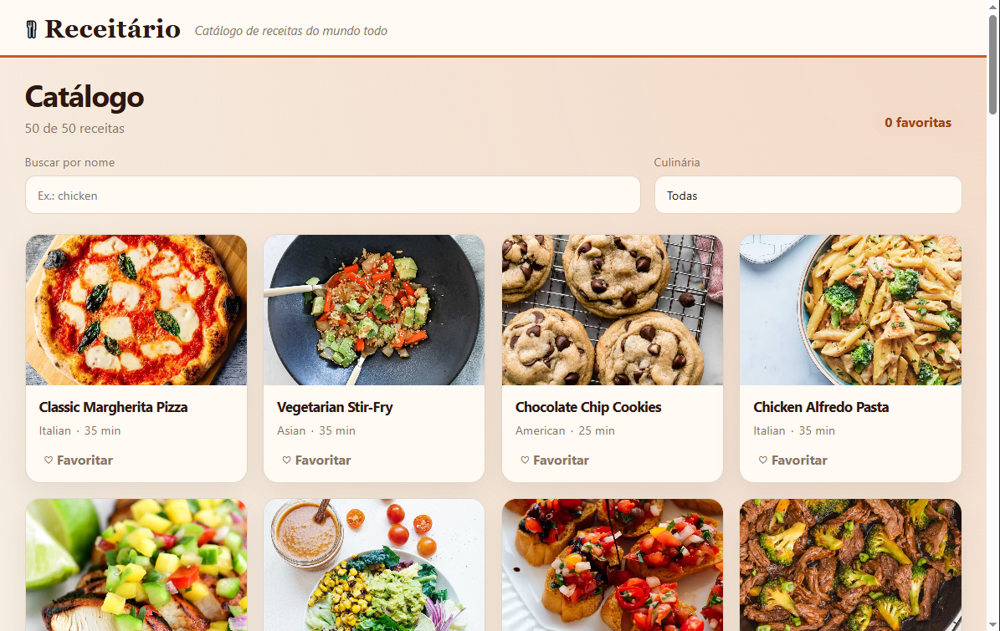

# Receitário

Catálogo de receitas em **React + Vite + TypeScript**, consumindo a API pública [DummyJSON Recipes](https://dummyjson.com/docs/recipes).

## Integrantes

| Nome | RM |
| --- | --- |
| Arthur Zambão Leite | 574150 |
| Gabriel Soares Tavares | 571113 |
| Yuto Arakaki Inoue | 573161 |

## Deploy

URL pública na Vercel: _preencher após o deploy_

## Catálogo



## Como executar

```bash
npm install
npm run dev
```

O app sobe em `http://localhost:5173`.

```bash
npm run build
```

## Rotas

- `/` — catálogo com busca por nome, filtro de culinária e favoritos locais
- `/receitas/:id` — detalhe da receita
- qualquer outra rota — página 404
